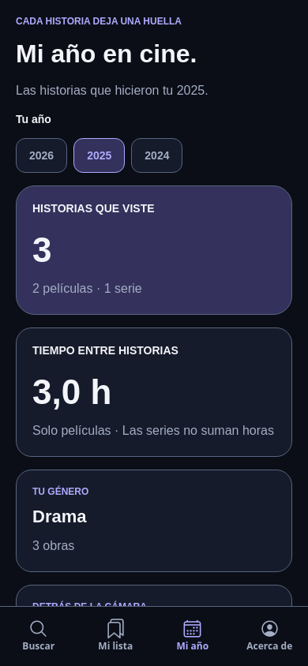
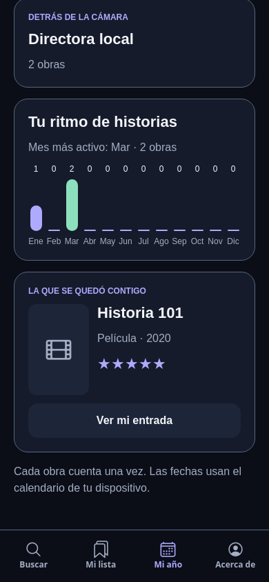

# Revisión final antes del commit de implementación

Estado: implementación preparada en la rama local epica-mi-anio; **todavía no confirmada ni publicada**. La spec y los tests rojos ya están en el historial, tras la aprobación de Ian. La revisión siguiente corresponde al código concreto resultante.

## Qué cambia

| Parte           | Resultado                                                                                     | Archivo principal                                              |
| --------------- | --------------------------------------------------------------------------------------------- | -------------------------------------------------------------- |
| Resumen anual   | Totales, horas de películas, género/director, doce meses, destacada y años disponibles        | src/dominio/resumenAnual.ts                                    |
| Fecha           | Timestamp de servidor al entrar a Vista; null al salir; se conserva al editar opinión         | src/dominio/visionado.ts y src/services/listaService.ts        |
| Compatibilidad  | Migra fechas antiguas desde actualizadoEn y luego metadatos seleccionados, sin borrar opinión | src/services/preparacionService.ts                             |
| Estado y caché  | Progreso, secuencia, cancelación, bloqueo de escrituras inciertas y guardas de sesión         | src/context/CarteleraContext.tsx                               |
| Seguridad       | Campos nuevos validados, listas de texto hasta diez, duración válida y dueño del documento    | firestore.rules                                                |
| Interfaz        | Cuarta pestaña Mi año, carga/vacío/parcial/offline/error/reintento y destacada editable       | src/screens/MiAnioScreen.tsx y src/components/ResumenAnual.tsx |
| Diseño anterior | Pantallas conservadas migran a tokens; SVG oficial TMDB íntegro                               | src/tema, src/screens y src/components                         |
| Entrega         | README, auditoría final, bitácora de cinco momentos, guion de demo y verificación humana      | README.md y docs/                                              |

No se agregaron dependencias de producción ni librerías de gráficas. Vitest y Prettier ya se justificaron/instalaron en H1. El runner opcional de navegador utiliza Playwright externo al paquete móvil.

## Resultado visible

También se incluyen resumen-vacio-local.png, resumen-parcial-local.png, resumen-offline-local.png y resumen-error-local.png. Son capturas de la app exportada a web con cuentas/datos de prueba; no son pruebas en teléfono.

## Comprobaciones

- npm test: 82 Vitest + 11 originales de Node = **93 aprobadas**.
- Firestore Emulator: **15 aprobadas**, incluido aislamiento A/B y duración inválida.
- Navegador móvil local: **21 comprobaciones aprobadas**; registra migración, fallo/reintento, edición concurrente, offline, caché por uid, cambio de cuenta, error sin copia y pestañas visibles al desplazar.
- TypeScript y lint limpios; formato y git diff --check correctos.
- Exportaciones web, Android e iOS generadas. No acreditan Expo Go.
- Sensor de colores demostrado en rojo con una infracción temporal y devuelto a verde sin excluir archivos ni saltar tests.

Salidas reales: H4-tests-verde.txt, H4-reglas-verde.txt, H4-UI-local.txt y H4-sensor-experimento-rojo.txt. El diff de código, reglas, pruebas y README se entrega en cambios-implementacion.diff, incluidos los archivos nuevos. Los documentos recogen los pendientes sin atribuir resultados humanos.

## Historial conservado

94f278c es P3 y está etiquetado p3-final. Los commits a47b34e y 4dca57c registran auditoría/harness; 8b3c179 fija los documentos/diseño revisados; e82a969 registra la spec; 141aaa3 guarda los tests rojos. La implementación preparada iría después, con mensaje propuesto: `feat: incorpora mi año en cine con migraciones y diseño`.

## Lo que falta para entregar

1. Ian revisa y aprueba este resultado/diff antes del commit final. Lo exige el enunciado §1.11 y AGENTS.md, sección Git y revisión: «Mostrar el diff y obtener la revisión del estudiante antes de cada commit».
2. Publicar rama y etiqueta en GitHub desde una sesión autenticada. El acceso actual es solo lectura; no se ha hecho push.
3. Publicar las reglas revisadas en el Firebase propio y capturar un documento real con los cuatro campos nuevos. El emulador no cuenta como publicación.
4. Probar en Expo Go, completar a mano la última columna de docs/VERIFICACION.md y ensayar docs/DEMO.md. Comprobar el harness en Claude Code si el docente exige esa herramienta.

No se leyó ni se incluyó .env. No hace falta compartir claves para revisar ni aprobar este código.

## Aprobación recibida

Ian aprobó el resultado y el diff con el mensaje «Apruebo la implementación y el commit final». El estado indicado arriba describe lo presentado para esa revisión; a partir de la aprobación se autoriza registrar el commit y continuar la publicación de la rama. Las pruebas personales y las reglas de Firebase productivo siguen pendientes.
